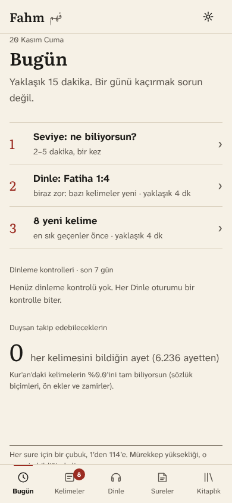
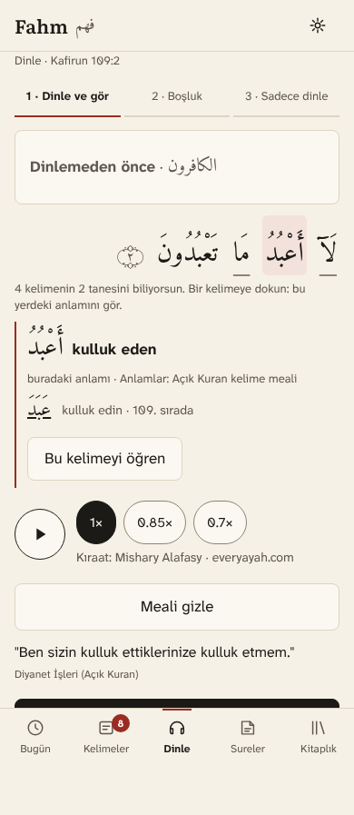
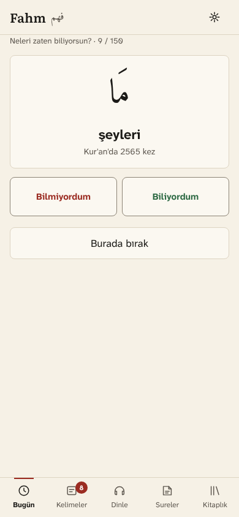
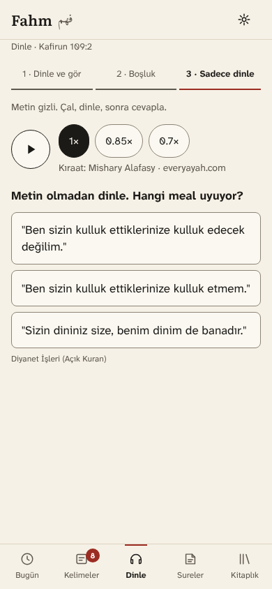
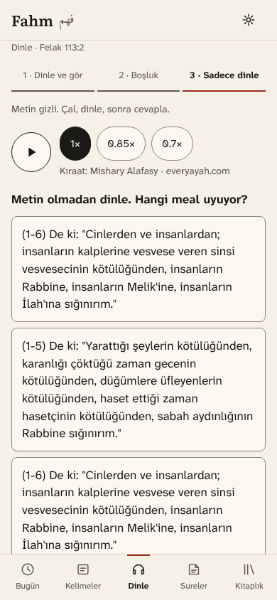
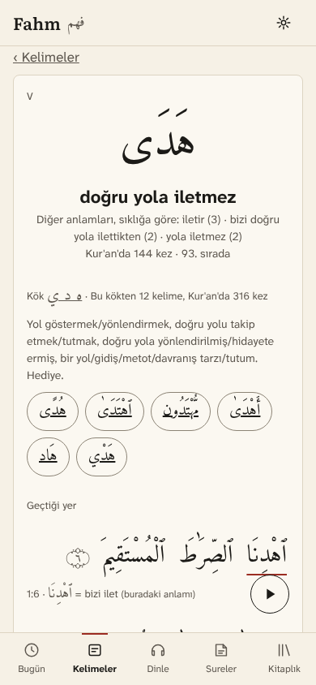
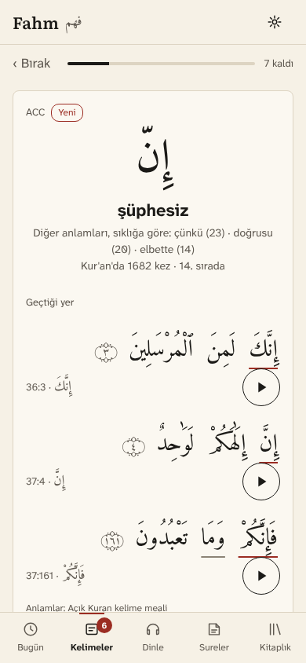
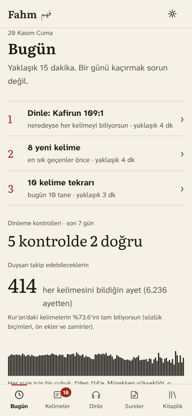

# Phase 1 review: critic (2026-11-20)

Tested as Umut at 390 × 844, `tr-TR` (and `en-GB` once). Day 1 from a clean start; day 30 from `seed-state.mjs 300 tr`.

**Limits.** I could not hear the audio; I only checked that the mp3 loads (everyayah returns 206, the button shows "playing"). Açık Kuran meanings cover only surahs 1–16 and 78–114 for now (40,868 of 77,429 words have no Turkish meaning-here); not counted as a bug. The day-30 seed ignores the My-surahs boost, so its surah percentages are not realistic.

## 1. Verdict
The skeleton is right: listening comes first, verses come from his own surahs, and tapping a word for its meaning in that place really helps. But in Turkish, the parts that should build and measure understanding are broken: word cards teach wrong meanings, and the listening check can be passed without listening. He would come back for the tap-to-meaning reader, but stop trusting the cards once he sees هَدَى = "doğru yola iletmez" ("does not guide").

## 2. What works
- Calm, fast, readable; large clear Arabic; no console errors.
- Today leads with listening, no streaks, and shows "5 kontrolde 2 doğru" next to coverage.
- Listen picks well. Day 1: Fatiha 1:4, then Kafirun 109:2. Day 30: verses where he knows every word, from his own surahs.
- Tapping a word shows the meaning in that verse, its parts, their rank, and "Bu kelimeyi öğren" ([03](phase-1/03-listen-pass1-kafirun.png)). This is the best feature.
- Prefix meanings are good Turkish; the pronouns lesson is clear; English meanings-here are good (1:4 ٱلدِّين = "Judgment").
- Text contrast passes AA in light and dark (6.2–7.5 : 1 measured).

 

## 3. Problems, most important first

**1. Turkish word cards show a random inflected form, often a negative one.** The card shows the most common Turkish rendering from Açık Kuran's word-by-word. In the top 1,000 items, 1 of 341 verb meanings is a dictionary form. Examples: هَدَى = "doğru yola iletmez", أَرْسَلَ = "biz göndermedik", قَتَلَ = "öldürmeyin", أُدْخِلَ = "sokarsan", قَالَ = "de ki", كَانَ = "oldukları", مَا = "şeyleri". Placement uses them too: "did you know مَا = şeyleri?" ([02](phase-1/02-placement-ma-sheyleri.png), [06](phase-1/06-card-hada-negated.png)). "Other meanings" splits one sense by suffix (-den / -dan / -nden).
*Why it matters:* he memorises wrong or opposite meanings. *Fix:* never use a per-place string as the main card meaning. Use a sourced dictionary-style meaning; show real forms underneath. Add a build check that flags negative endings (-me/-ma/-mez, "değil") and commands. Merge senses that differ only by suffix or capital.

**2. The listening check does not measure listening.**
- (a) Diyanet often translates verses as one group: 30 of the 55 verses in My surahs carry a group translation such as "(2-4) …". The answer for 1:4 is the translation of 1:2–4, and the "(2-4)" label gives it away. In Felak 113:2 two of the three options are the same Nas text ([05](phase-1/05-listen-check-felak-duplicates.png)). In Kureyş 106:3 the right option contains "Kureyş'i", and the header says "Kureyş".
- (b) He read the translation in pass 1 a minute earlier, the header names the verse, and he can answer without pressing play.
- (c) Kafirun 109:2 is tested against 109:4, which is almost the same sentence ([04](phase-1/04-listen-check-kafirun-near-twins.png)). That is a trick question, not a check of meaning.

*Why it matters:* PLAN §1 calls this the honest measure; now it measures memory of the screen. *Fix:* one translation per verse (for Turkish this needs Umut's choice), no duplicate or near-identical options, options only after playing, no verse reference in pass 3, and grammar questions ("Who speaks: I / we / you?").

**3. Turkish "meaning here" drops the person.** أَعْبُدُ = "kulluk eden" (should be "I serve"), لَآ = "olmam", يَٰٓأَيُّهَا = "ve ey". The English shows "I worship". *Why:* "who speaks to whom" is the goal. *Fix:* show the person from the Corpus features (1S → "ben") next to every verb's meaning.

**4. The numbers flatter.** One "Zorlandım" on a never-seen card, or one placement "Biliyordum", makes a word "known". After day 1: "kelimelerin %17.5'ini tam biliyorsun"; day 30: 73.6% ([08](phase-1/08-day30-today.png)). *Fix:* "known" only after a correct recall on a later day; use the agreed name "dictionary-form coverage"; mark placement words unchecked.

**5. Bugs.**
- Each tap on a self-report chip adds another report (two taps gave count 2, sum 3).
- Card labels show raw Corpus codes: ACC, N, V, ADJ, PN ([07](phase-1/07-card-acc-label.png)).
- The "Dinlemeden önce" card closes on every word tap.
- With English chosen on a Turkish phone, numbers show as "6.236".

**6. The word card is slow on a phone.** The grade buttons sit below three example verses, so every card needs a scroll. Examples are random verses (56:38, 37:161 — half a sentence), not from his surahs, with no translation. *Fix:* fixed grade buttons; examples from My surahs with translation.

**7. Turkish wording.**
- "%73.6'ini": Turkish needs a decimal comma, and the fixed "'ini" is wrong for most numbers. Write "Bildiğin oran: %73,6".
- "Ayeti çal": "çal" is for music and jars for the Quran. Use "Dinle" or "Oynat".
- "Boşluk" names a step with no blank: "Anlamı seç". "Mürekkep yüksekliği" → "Çubuğun boyu". "1 gün sonra" → "yarın". "bilirsen … biliyorsun" → "bilirsin".
- Settings and About mix in English ("Device / Cihaz", About body). Roots list "1 / 3 ✓" is unclear.
- Fatiha 1:1 in Turkish is "Bismillahirrahmanirrahim.": no meaning.

**8. Tap targets.** Reader word buttons are 28–41 px wide; back links 22 px tall, root link 17 px. Breaks the 48 px rule and WCAG 2.2's 24 px minimum.

**9. Smaller.** Placement has 150 cards, so "2–5 dakika" is untrue; "Bilmiyordum" words are not added though it says "14 öğrenilecek". Day 30 Listen chose 15:93, half a sentence. The context card has only type, order and name meaning.

## 4. Missing for the goal (ranked)
1. **Ear-first practice.** Cards have no sound; nothing trains hearing a word inside recitation.
2. **Verb person markers** (أَ / نَ / تَ…ونَ / يَ…ونَ, past endings): the "who speaks" half of the goal. Only pronoun endings are taught.
3. **Whole short surahs.** He hears them as wholes; Turkish translations are already grouped that way.
4. **Self-report compared with checks.** The data is stored but never shown.
5. **Progress over time:** check history, and verses he can newly follow in My surahs.
6. **Context:** what the surah says, and to whom.

## 5. Top 7 changes for Phase 2
1. Replace the Turkish card meanings with dictionary-style sourced meanings, and add a build check for negative and command forms.
2. Rebuild the listening check: one translation per verse, no duplicate or near-twin options, options only after playing, no reference shown, plus "who speaks?" questions.
3. Show the person/number on every verb's meaning in that place, and add the verb person-marker lesson.
4. Make the numbers honest: "known" only after a correct recall on a later day; rename to dictionary-form coverage; mark placement words unchecked.
5. Fix the bugs: self-report counted twice, raw POS codes, duplicate options, context card collapsing, Turkish numbers and endings, "çal".
6. Add ear-first review and whole-surah listening for My surahs.
7. Fix the word card layout: grade buttons always visible, examples from My surahs with translation, all tap targets 48 px or more.

## Screenshots (390 px)
     
